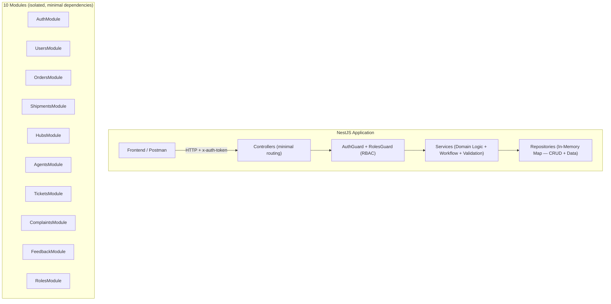
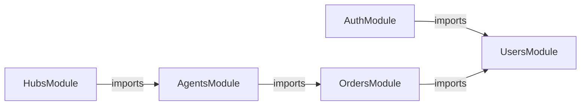
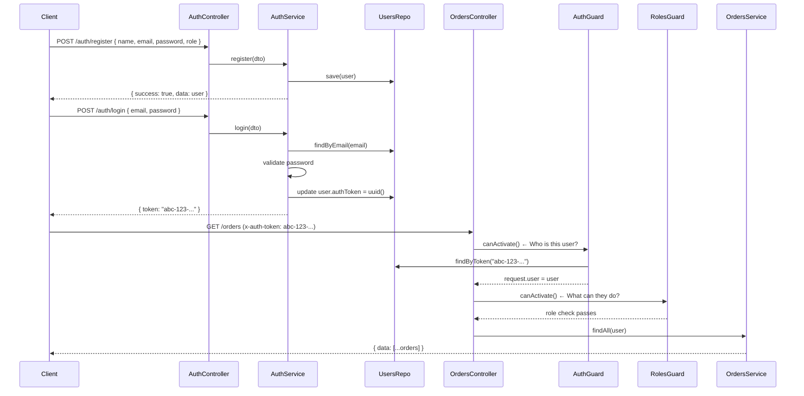
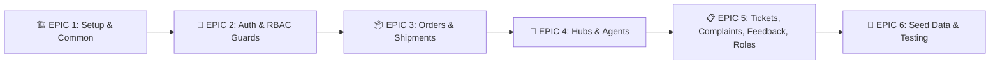

# SwiftTrack Backend — NestJS Implementation Plan

## 1. Requirements

| # | Requirement | Solution |
|---|-------------|----------|
| 1 | **NestJS framework** | NestJS 10+ with TypeScript |
| 2 | **In-memory database** | Custom in-memory repositories (`Map<string, T>` per entity) — designed so migration to MongoDB requires minimal changes |
| 3 | **Modules matching frontend** | Auth, Users, Orders, Shipments, Hubs, Agents, Tickets, Complaints, Feedback, Roles |
| | **5 Roles** | `super_user`, `hub_manager` (acts as admin), `merchant`, `delivery_agent`, `customer` |
| 4 | **Header-based auth** | Custom `AuthGuard` reading `x-auth-token` header (not JWT) |
| 5 | **Validation** | `class-validator` + `class-transformer` with DTOs |
| 6 | **Layered architecture** | Repository → Service → Controller → Module |
| 7 | **RBAC** | NestJS Guards (`RolesGuard` + `@Roles()` decorator) — Authorization only |
| 8 | **Exception handling** | Throw typed NestJS exceptions throughout service layer for easier debugging |

---

## 2. Architecture



### 2.1 Technology Stack

| Layer | Technology | Purpose |
|-------|-----------|---------|
| **Framework** | NestJS 10+ | DI, Guards, Pipes, Interceptors, Modules |
| **Language** | TypeScript | Type safety, interfaces, decorators |
| **Database** | In-Memory (`Map`) | No external DB; each repository wraps a `Map<string, T>` — minimal coupling so MongoDB migration is easy |
| **Auth** | Custom Header Guard | Reads `x-auth-token`, validates against stored user tokens |
| **RBAC** | NestJS Guards | `RolesGuard` + `@Roles()` decorator — handles **authorization only** |
| **Validation** | class-validator + class-transformer | DTO validation with decorators |
| **API Docs** | @nestjs/swagger | Auto-generated Swagger UI at `/api/docs` |

### 2.2 5-Step Build Order (per module)

> ⚠️ **Always follow this order.** Do not skip steps or build top-down.

```
Step 1 → Repository   (Data + CRUD operations on Map)
Step 2 → DTOs         (Request/response shape + class-validator)
Step 3 → Service      (Domain rules + workflow + validation logic)
Step 4 → Controller   (Endpoints only — single lines, no business logic)
Step 5 → Module       (Wire together, exports/imports as few as possible)
```

| Step | File | Responsibility |
|------|------|---------------|
| **1 — Repository** | `entity.repository.ts` | Owns the `Map<string, T>`. Exposes `findAll`, `findById`, `create`, `update`, `delete`. No logic. |
| **2 — DTO** | `dto/create-entity.dto.ts`, `dto/update-entity.dto.ts` | Defines the shape of requests and responses. Carries all class-validator decorators. |
| **3 — Service** | `entity.service.ts` | Domain rules (close to repo), workflow, validation logic. This is where the business is scaled. Throws typed exceptions. |
| **4 — Controller** | `entity.controller.ts` | HTTP routing only — delegates immediately to service. Each method should be a single line. |
| **5 — Module** | `entity.module.ts` | Imports/exports. Dependencies kept minimal — makes modules isolated and scalable. |

### 2.3 Coupling & Caution Rules

| Rule | Detail |
|------|--------|
| **Controller = routing only** | Controllers should be as minimal as possible. No business logic, no if/else, no validation. |
| **Service = all logic** | Domain rules, workflow, cross-entity checks, and validation all live here. |
| **One repository per module** | Multiple repositories per module hurt scalability and testability. Avoid. |
| **Minimal module dependencies** | Modules communicate only via exports/imports. The fewer cross-module imports, the better. |
| **Write exceptions always** | Throw descriptive `BadRequestException`, `NotFoundException`, `ForbiddenException` etc. in services. Makes debugging dramatically easier. |
| **RBAC = authorization only** | `RolesGuard` checks *what* a user can do. Authentication (who the user is) is handled separately by `AuthGuard`. |
| **Domain rules close to repo** | Domain-level checks (e.g. "does this entity exist?") should live at the bottom of the service, closest to the repository calls. |

### 2.4 Cross-Module Dependencies

> Modules must explicitly import other modules to use their services. Keep these to a minimum.



| Module | Imports | Why |
|--------|---------|-----|
| `AuthModule` | `UsersModule` | Needs `UsersRepository` to find/store users and tokens |
| `OrdersModule` | `UsersModule` | Validates merchantId and customerId against users |
| `AgentsModule` | `OrdersModule` | `GET /agents/:id/worklist` — fetches orders assigned to agent |
| `HubsModule` | `AgentsModule` | `GET /hubs/:id/agents` — lists agents belonging to a hub |

All other modules are self-contained with no cross-module imports.

---

## 3. Project Structure

```
backend/
├── nest-cli.json
├── package.json
├── tsconfig.json
├── src/
│   ├── main.ts                             # Bootstrap: CORS, ValidationPipe, Swagger
│   ├── app.module.ts                       # Root module
│   │
│   ├── auth/
│   │   ├── auth.module.ts
│   │   ├── auth.controller.ts              # POST /auth/login, /auth/register, /auth/logout
│   │   ├── auth.service.ts
│   │   ├── guards/
│   │   │   ├── auth.guard.ts               # x-auth-token header guard (Authentication)
│   │   │   └── roles.guard.ts              # @Roles() check (Authorization / RBAC)
│   │   ├── decorators/
│   │   │   ├── roles.decorator.ts          # @Roles('hub_manager','merchant')
│   │   │   └── current-user.decorator.ts   # @CurrentUser()
│   │   └── dto/
│   │       ├── login.dto.ts
│   │       └── register.dto.ts
│   │
│   ├── users/
│   │   ├── users.module.ts
│   │   ├── users.controller.ts             # Minimal — delegates to service
│   │   ├── users.service.ts                # Domain logic + validation + exceptions
│   │   ├── users.repository.ts             # Map<string, IUser> CRUD only
│   │   ├── interfaces/
│   │   │   └── user.interface.ts
│   │   └── dto/
│   │       ├── create-user.dto.ts
│   │       └── update-user.dto.ts
│   │
│   ├── orders/
│   │   ├── orders.module.ts
│   │   ├── orders.controller.ts
│   │   ├── orders.service.ts
│   │   ├── orders.repository.ts
│   │   ├── interfaces/
│   │   │   └── order.interface.ts
│   │   └── dto/
│   │       ├── create-order.dto.ts
│   │       ├── update-order.dto.ts
│   │       └── assign-agent.dto.ts
│   │
│   ├── shipments/
│   │   ├── shipments.module.ts
│   │   ├── shipments.controller.ts
│   │   ├── shipments.service.ts
│   │   ├── shipments.repository.ts
│   │   ├── interfaces/
│   │   │   └── shipment.interface.ts
│   │   └── dto/
│   │       ├── create-shipment.dto.ts
│   │       └── update-shipment.dto.ts
│   │
│   ├── hubs/
│   │   ├── hubs.module.ts
│   │   ├── hubs.controller.ts
│   │   ├── hubs.service.ts
│   │   ├── hubs.repository.ts
│   │   ├── interfaces/
│   │   │   └── hub.interface.ts
│   │   └── dto/
│   │       ├── create-hub.dto.ts
│   │       └── update-hub.dto.ts
│   │
│   ├── agents/
│   │   ├── agents.module.ts
│   │   ├── agents.controller.ts
│   │   ├── agents.service.ts
│   │   ├── agents.repository.ts
│   │   ├── interfaces/
│   │   │   └── agent.interface.ts
│   │   └── dto/
│   │       └── update-availability.dto.ts
│   │
│   ├── tickets/
│   │   ├── tickets.module.ts
│   │   ├── tickets.controller.ts
│   │   ├── tickets.service.ts
│   │   ├── tickets.repository.ts
│   │   ├── interfaces/
│   │   │   └── ticket.interface.ts
│   │   └── dto/
│   │       ├── create-ticket.dto.ts
│   │       └── update-ticket.dto.ts
│   │
│   ├── complaints/
│   │   ├── complaints.module.ts
│   │   ├── complaints.controller.ts
│   │   ├── complaints.service.ts
│   │   ├── complaints.repository.ts
│   │   ├── interfaces/
│   │   │   └── complaint.interface.ts
│   │   └── dto/
│   │       ├── create-complaint.dto.ts
│   │       └── update-complaint.dto.ts
│   │
│   ├── feedback/
│   │   ├── feedback.module.ts
│   │   ├── feedback.controller.ts
│   │   ├── feedback.service.ts
│   │   ├── feedback.repository.ts
│   │   ├── interfaces/
│   │   │   └── feedback.interface.ts
│   │   └── dto/
│   │       ├── create-feedback.dto.ts
│   │       └── update-feedback.dto.ts      # For PUT /feedback/:id (review status update)
│   │
│   ├── roles/
│   │   ├── roles.module.ts
│   │   ├── roles.controller.ts
│   │   ├── roles.service.ts
│   │   ├── roles.repository.ts
│   │   ├── interfaces/
│   │   │   └── role.interface.ts
│   │   └── dto/
│   │       └── update-role.dto.ts
│   │
│   ├── common/
│       ├── interfaces/
│       │   └── api-response.interface.ts
│       ├── filters/
│       │   └── http-exception.filter.ts    # Global — catches all thrown exceptions
│       └── constants/
│           ├── roles.constant.ts
│           └── statuses.constant.ts
│
│   └── seed/
│       ├── seed.module.ts                  # Imported by AppModule
│       └── seed.service.ts                 # OnModuleInit — seeds all repositories on startup

└── test/
    ├── auth.e2e-spec.ts
    ├── orders.e2e-spec.ts
    └── shipments.e2e-spec.ts
```

---

## 4. Data Models (Interfaces)

### 4.1 User

```typescript
// src/users/interfaces/user.interface.ts
export interface IUser {
  id: string;
  name: string;
  email: string;
  password: string;
  role: 'super_user' | 'hub_manager' | 'merchant' | 'delivery_agent' | 'customer';
  hubId?: string;          // for hub_manager and delivery_agent
  phone?: string;
  company?: string;        // for merchant
  isActive: boolean;
  authToken?: string;      // set on login, cleared on logout
  createdAt: Date;
  updatedAt: Date;
}
```

### 4.2 Order

```typescript
// src/orders/interfaces/order.interface.ts
export interface IOrder {
  id: string;
  orderId: string;         // e.g. "ORD_1"
  trackingId: string;      // e.g. "ST-100001"
  merchantId: string;
  customerId: string;
  customerName: string;
  customerPhone?: string;
  pickupAddress?: string;
  deliveryAddress: string;
  pickupHubId?: string;
  deliveryHubId?: string;
  status: 'Pending' | 'Assigned' | 'PickedUp' | 'InTransit' | 'OutForDelivery' | 'Delivered' | 'Cancelled';
  assignedAgentId?: string;
  packageType?: string;
  weight?: number;
  amount?: number;
  paymentMode?: 'Prepaid' | 'COD';
  priority: 'Low' | 'Medium' | 'High';
  estimatedDelivery?: Date;
  createdAt: Date;
  updatedAt: Date;
}
```

### 4.3 Shipment

```typescript
// src/shipments/interfaces/shipment.interface.ts
export interface IShipment {
  id: string;
  shipmentId: string;      // e.g. "SWT-2026-98471"
  merchantId: string;
  recipient: string;
  origin: string;
  destination: string;
  service: 'Express' | 'Standard' | 'Overnight';
  weight?: string;
  amount?: string;
  status: 'pending' | 'picked-up' | 'in-transit' | 'delivered' | 'cancelled';
  createdAt: Date;
  updatedAt: Date;
}
```

### 4.4 Hub

```typescript
// src/hubs/interfaces/hub.interface.ts
export interface IHub {
  id: string;
  hubId: string;           // e.g. "H001"
  name: string;
  location: string;
  status: 'Active' | 'Inactive';
  createdAt: Date;
}
```

### 4.5 Agent Profile

```typescript
// src/agents/interfaces/agent.interface.ts
export interface IAgentProfile {
  id: string;
  userId: string;          // references User.id
  name: string;
  phone?: string;
  hubId: string;
  availabilityStatus: 'Available' | 'Busy' | 'Offline';
  vehicleType?: string;
  currentTasksCount: number;
  createdAt: Date;
  updatedAt: Date;
}
```

### 4.6 Ticket

```typescript
// src/tickets/interfaces/ticket.interface.ts
export interface ITicket {
  id: string;
  ticketId: string;        // e.g. "TKT-1042"
  merchantId: string;
  subject: string;
  trackingId?: string;
  priority: 'low' | 'med' | 'high';
  status: 'open' | 'in-progress' | 'resolved' | 'closed';
  createdAt: Date;
  updatedAt: Date;
}
```

### 4.7 Complaint

```typescript
// src/complaints/interfaces/complaint.interface.ts
export interface IComplaint {
  id: string;
  userId: string;
  orderId?: string;
  description: string;
  status: 'Open' | 'In Progress' | 'Resolved';
  createdAt: Date;
  updatedAt: Date;
}
```

### 4.8 Feedback

```typescript
// src/feedback/interfaces/feedback.interface.ts
export interface IFeedback {
  id: string;
  userId: string;
  orderId?: string;
  rating: number;          // 1-5
  comments?: string;
  status: 'New' | 'Reviewed' | 'Actioned';
  createdAt: Date;
}
```

### 4.9 Role

```typescript
// src/roles/interfaces/role.interface.ts
export interface IRole {
  id: string;
  roleId: string;          // e.g. "super_user"
  name: string;
  description?: string;
  isSystem: boolean;
  permissions: Record<string, boolean>;  // { view_users: true, create_orders: false, ... }
  createdAt: Date;
  updatedAt: Date;
}
```

### 4.10 Standard API Response Pattern

All controllers return this wrapper via `IApiResponse<T>`:

```typescript
// src/common/interfaces/api-response.interface.ts
export interface IApiResponse<T> {
  success: boolean;
  data?: T;
  message?: string;
  error?: string;
}

// Usage in service/controller:
return { success: true, data: order };
return { success: false, error: 'Order not found' };
```

---

## 5. Authentication & Authorization

> [!IMPORTANT]
> **Authentication** (`AuthGuard`): Reads `x-auth-token` header, looks up user, attaches to `request.user`.
> **Authorization** (`RolesGuard`): Checks `@Roles()` decorator against `request.user.role`. These are **two separate concerns**.

### Auth Flow



### RBAC Guard Pattern

```typescript
// Every protected controller uses both guards:
@UseGuards(AuthGuard, RolesGuard)
@Roles('hub_manager', 'super_user')
@Get()
findAll(@CurrentUser() user: IUser) {
  return this.service.findAll(user);  // Single line — no logic in controller
}
```

---

## 6. API Endpoints

### 6.1 Auth

| Method | Endpoint | Description | Auth |
|--------|----------|-------------|:----:|
| `POST` | `/auth/register` | Register user | ❌ |
| `POST` | `/auth/login` | Login → returns token | ❌ |
| `POST` | `/auth/logout` | Invalidate token | ✅ |

### 6.2 Users (Super User / Hub Manager)

| Method | Endpoint | Description | Roles |
|--------|----------|-------------|-------|
| `GET` | `/users` | List all users | super_user, hub_manager |
| `GET` | `/users/:id` | Get user by ID | super_user, hub_manager, self |
| `POST` | `/users` | Create user | super_user, hub_manager |
| `PUT` | `/users/:id` | Update user | super_user, hub_manager |
| `DELETE` | `/users/:id` | Delete user | super_user |
| `PATCH` | `/users/:id/approve` | Approve pending user | super_user, hub_manager |

### 6.3 Orders (Hub Manager + Merchant + Customer)

| Method | Endpoint | Description | Roles |
|--------|----------|-------------|-------|
| `GET` | `/orders` | List orders (role-filtered) | all authenticated |
| `GET` | `/orders/:id` | Get order details | all authenticated |
| `POST` | `/orders` | Create order | merchant |
| `PUT` | `/orders/:id` | Update order | merchant, hub_manager |
| `PATCH` | `/orders/:id/status` | Update status | hub_manager, delivery_agent |
| `PATCH` | `/orders/:id/assign` | Assign agent | hub_manager |
| `DELETE` | `/orders/:id` | Cancel order | merchant (before dispatch) |

### 6.4 Shipments (Merchant)

| Method | Endpoint | Description | Roles |
|--------|----------|-------------|-------|
| `GET` | `/shipments` | List shipments (own) | merchant |
| `GET` | `/shipments/:id` | Get shipment | merchant (own), super_user |
| `POST` | `/shipments` | Create shipment | merchant |
| `PUT` | `/shipments/:id` | Update shipment | merchant (own) |
| `DELETE` | `/shipments/:id` | Cancel shipment | merchant (own) |
| `GET` | `/shipments/:id/track` | Get tracking timeline | all authenticated |

### 6.5 Hubs

| Method | Endpoint | Description | Roles |
|--------|----------|-------------|-------|
| `GET` | `/hubs` | List all hubs | hub_manager, super_user |
| `GET` | `/hubs/:id` | Get hub details | hub_manager, super_user |
| `POST` | `/hubs` | Create hub | super_user |
| `PUT` | `/hubs/:id` | Update hub | super_user |
| `GET` | `/hubs/:id/agents` | List agents for hub | hub_manager |

### 6.6 Agents

| Method | Endpoint | Description | Roles |
|--------|----------|-------------|-------|
| `GET` | `/agents` | List all agents | hub_manager, super_user |
| `GET` | `/agents/:id` | Get agent profile | hub_manager, self |
| `GET` | `/agents/:id/worklist` | Get assigned orders | delivery_agent (self) |
| `PATCH` | `/agents/:id/availability` | Update status | delivery_agent (self) |

### 6.7 Tickets (Merchant)

| Method | Endpoint | Description | Roles |
|--------|----------|-------------|-------|
| `GET` | `/tickets` | List tickets (own) | merchant |
| `POST` | `/tickets` | Create ticket | merchant |
| `PUT` | `/tickets/:id` | Update ticket | merchant (own), super_user |
| `DELETE` | `/tickets/:id` | Delete ticket | merchant (own) |

### 6.8 Complaints (Customer + Super User)

| Method | Endpoint | Description | Roles |
|--------|----------|-------------|-------|
| `GET` | `/complaints` | List complaints | customer (own), super_user (all) |
| `POST` | `/complaints` | Create complaint | customer |
| `PUT` | `/complaints/:id` | Update status | super_user |

### 6.9 Feedback (Customer + Super User)

| Method | Endpoint | Description | Roles |
|--------|----------|-------------|-------|
| `GET` | `/feedback` | List feedback | customer (own), super_user (all) |
| `POST` | `/feedback` | Submit feedback | customer |
| `PUT` | `/feedback/:id` | Update review status | super_user |

### 6.10 Roles (Super User)

| Method | Endpoint | Description | Roles |
|--------|----------|-------------|-------|
| `GET` | `/roles` | List all roles | super_user |
| `GET` | `/roles/:id` | Get role details | super_user |
| `PUT` | `/roles/:id` | Update permissions | super_user |

---

## 7. Validation Rules (Service Layer)

> ⚠️ All validation and domain logic lives in the **service layer**. Controllers never validate. Always throw typed NestJS exceptions — this makes debugging much easier.

### 7.1 User Validation

| Rule | Exception to Throw |
|------|-------|
| Email must be unique | `ConflictException('Email already exists')` |
| Password min 6 chars | Handled by DTO `@MinLength(6)` |
| Role must be valid enum | Handled by DTO `@IsIn([...])` |
| Cannot delete yourself | `BadRequestException('Cannot delete your own account')` |

### 7.2 Order Validation

| Rule | Exception to Throw |
|------|-------|
| merchantId must reference existing merchant | `BadRequestException('Invalid merchant')` |
| customerId must reference existing customer | `BadRequestException('Invalid customer')` |
| Status transitions must be valid (no skipping) | `BadRequestException('Invalid status transition')` |
| Can only cancel before status = Assigned | `BadRequestException('Cannot cancel dispatched order')` |
| assignedAgentId must reference existing agent | `BadRequestException('Invalid agent')` |

### 7.3 Shipment Validation

| Rule | Exception to Throw |
|------|-------|
| merchantId auto-set from authenticated user | — |
| shipmentId auto-generated as `SWT-YYYY-XXXXX` | — |
| Can only cancel if status = pending | `BadRequestException('Cannot cancel shipped item')` |

### 7.4 Exception Handling Pattern

```typescript
// ✅ CORRECT — throw descriptive exceptions in service layer
findById(id: string): IOrder {
  const order = this.ordersRepository.findById(id);
  if (!order) throw new NotFoundException(`Order ${id} not found`);
  return order;
}

// ❌ WRONG — silent failure, impossible to debug
findById(id: string): IOrder | undefined {
  return this.ordersRepository.findById(id);
}
```

### 7.5 Project-Wide Business Rules

| Rule | Description |
|------|-------------|
| **Role-scoped data** | Merchants see only their own shipments/orders; customers see only their own orders/complaints/feedback; hub_managers see orders for their hub; agents see their assigned worklist |
| **Ownership enforcement** | Updates/deletes check that the requester is the owner or admin — throw `ForbiddenException` otherwise |
| **Status machine** | Orders follow: `Pending → Assigned → PickedUp → InTransit → OutForDelivery → Delivered` (no skipping, no reversals) |

---

## 8. Seed Data

The repositories will be pre-populated on app startup with seed data matching the frontend's `mockData.js`. **When starting with a new module, only build `repository.ts` first — focus there before adding service or controller.**

```typescript
// Called from AppModule.onModuleInit() or a dedicated SeedService
// Seeds: 4 hubs, 9 users (1 per super_user + 2 per remaining role), 5 orders, 3 shipments, 5 roles
```

| Entity | Seed Count | Details |
|--------|:---:|---------|
| Users | 9 | 1 super_user, 2 hub_managers, 2 merchants, 2 delivery_agents, 2 customers |
| Hubs | 4 | Matching frontend hub data |
| Agent Profiles | 4 | Linked to delivery_agent users |
| Orders | 5 | Various statuses |
| Shipments | 3 | Linked to merchants |
| Tickets | 2 | Open and resolved |
| Complaints | 2 | Open and resolved |
| Feedback | 2 | With ratings |
| Roles | 5 | super_user, hub_manager, merchant, delivery_agent, customer (with permissions) |

---

## 9. Jira Sprint — Single Sprint

### Epic Structure



> **Build order within each epic:** Repository → DTOs → Service → Controller → Module

---

### 🚀 Sprint: SwiftTrack NestJS Backend

**Sprint Goal**: Build the complete NestJS backend matching all frontend modules
**Total Story Points**: 78

---

#### 🏗️ EPIC 1: Setup & Common (8 SP)

---

**ST-001 — Initialize NestJS Project** `3 SP`

> **Description**: Scaffold the NestJS backend from scratch and configure all global settings that every other module will rely on — CORS, validation, error handling, and API documentation. This is the foundation; nothing else can be built until this story is done and the app boots cleanly.

| # | Subtask |
|---|---------|
| 1.1 | Run `npx @nestjs/cli new backend` to scaffold the project, then verify TypeScript compiles without errors using `npm run build` |
| 1.2 | Install all required dependencies: `class-validator` and `class-transformer` for DTO validation, `@nestjs/swagger` for API docs, `uuid` for ID generation, and `bcrypt` for password hashing |
| 1.3 | In `main.ts`, enable CORS so the frontend can connect, register `ValidationPipe` globally so all DTOs are validated automatically, and register `HttpExceptionFilter` globally so all thrown exceptions return consistent JSON |
| 1.4 | Set up Swagger using `SwaggerModule.setup()` so the API is browsable at `/api/docs` with correct title, version, and bearer token input |
| 1.5 | Create a `.env` file with `PORT` and `APP_NAME` variables and load them via `@nestjs/config` in `AppModule` |

---

**ST-002 — Create Common Module** `3 SP`

> **Description**: Build the shared building blocks that every module will use — the standard API response wrapper, the global exception filter, and the constants for roles and order statuses. Getting these right upfront prevents inconsistency across modules later.

| # | Subtask |
|---|---------|
| 2.1 | Create `IApiResponse<T>` interface in `common/interfaces/` with fields `success: boolean`, `data?: T`, `message?: string`, and `error?: string` — this is the shape every controller response must follow |
| 2.2 | Build `HttpExceptionFilter` in `common/filters/` that catches all `HttpException` instances and formats them into `IApiResponse` shape with the correct HTTP status code, so error responses look identical to success responses |
| 2.3 | Create `roles.constant.ts` in `common/constants/` with a `Role` enum: `SUPER_USER`, `HUB_MANAGER`, `MERCHANT`, `DELIVERY_AGENT`, `CUSTOMER` — import this everywhere roles are referenced instead of using raw strings |
| 2.4 | Create `statuses.constant.ts` with an `OrderStatus` enum covering all six states (`Pending`, `Assigned`, `PickedUp`, `InTransit`, `OutForDelivery`, `Delivered`, `Cancelled`) and a `VALID_TRANSITIONS` map that defines which status can follow which, used by `OrdersService` to enforce the status machine |

---

**ST-003 — Create AppModule Skeleton** `2 SP`

> **Description**: Wire all 10 feature modules and the seed module into the root `AppModule` so the application has a complete dependency graph from day one. Verifying a clean boot here catches any circular dependency or misconfiguration early.

| # | Subtask |
|---|---------|
| 3.1 | Create `AppModule` and import all 10 feature modules (Auth, Users, Orders, Shipments, Hubs, Agents, Tickets, Complaints, Feedback, Roles) plus `SeedModule` — feature modules can be empty stubs at this stage |
| 3.2 | Run `npm run start:dev` and confirm the app starts on the configured port with zero errors in the console — fix any import or circular dependency issues before proceeding |

---

#### 🔐 EPIC 2: Auth & RBAC Guards (18 SP)

---

**ST-004 — Build AuthGuard + RolesGuard (RBAC)** `5 SP`

> **Description**: Implement the two guards that protect every endpoint in the application. `AuthGuard` handles authentication — it reads the `x-auth-token` header, finds the matching user, and attaches them to the request. `RolesGuard` handles authorization — it checks whether the authenticated user's role matches what the endpoint requires. These two guards must be completed before any other controller can be protected.

| # | Subtask |
|---|---------|
| 4.1 | Create `AuthGuard` in `auth/guards/` that reads the `x-auth-token` header from every incoming request — if the header is missing, throw `UnauthorizedException('Missing auth token')` immediately |
| 4.2 | Inside `AuthGuard.canActivate()`, call `UsersRepository.findByToken(token)` to look up which user owns this token — if no user is found (token is expired or invalid), throw `UnauthorizedException('Invalid or expired token')` |
| 4.3 | Attach the resolved user object to `request.user` so downstream services and decorators can access the caller's identity without repeating the lookup |
| 4.4 | Create a `@CurrentUser()` custom parameter decorator in `auth/decorators/` that extracts `request.user` from the execution context — this lets controllers write `@CurrentUser() user: IUser` instead of manually pulling from the request |
| 4.5 | Create `RolesGuard` in `auth/guards/` that reads the `@Roles()` metadata set on the route handler, compares it against `request.user.role`, and throws `ForbiddenException('You do not have permission to access this resource')` if there is no match |
| 4.6 | Create the `@Roles(...roles)` decorator in `auth/decorators/` using `SetMetadata` — this decorator is how controllers declare which roles are allowed for each endpoint |

---

**ST-005 — Build Auth Controller & Service** `5 SP`

> **Description**: Implement the three public authentication endpoints — register, login, and logout. These are the only endpoints in the entire app that do not require the `x-auth-token` header. The service handles password hashing, duplicate email detection, and token lifecycle management.

| # | Subtask |
|---|---------|
| 5.1 | Create `RegisterDto` with fields `name` (non-empty string), `email` (valid email format), `password` (minimum 6 characters), and `role` (must be one of the five valid Role enum values) — all validated using `class-validator` decorators |
| 5.2 | Create `LoginDto` with `email` (valid email) and `password` (non-empty string) fields |
| 5.3 | Implement `POST /auth/register` in `AuthService` — check if the email already exists in `UsersRepository` and throw `ConflictException('An account with this email already exists')` if it does, then hash the password using `bcrypt.hash(password, 10)` before saving the user |
| 5.4 | Implement `POST /auth/login` in `AuthService` — find the user by email and throw `UnauthorizedException('Invalid email or password')` if not found, then use `bcrypt.compare(plainPassword, hashedPassword)` to verify the password, generate a UUID token, save it to `user.authToken`, and return it to the client |
| 5.5 | Implement `POST /auth/logout` in `AuthService` — find the current user from the token, set `user.authToken` to `undefined`, and save the updated user back to the repository so the token is permanently invalidated |

---

**ST-006 — Build User Repository + DTOs** `4 SP`

> **Description**: Define the `IUser` data shape and build the `UsersRepository` that wraps the in-memory `Map`. This repository is the single source of truth for all user data and must expose enough lookup methods to serve both auth (find by token) and user management (find by email, ID) needs. No business logic belongs here — only raw data operations.

| # | Subtask |
|---|---------|
| 6.1 | Define the `IUser` interface in `users/interfaces/` with all required fields: `id`, `name`, `email`, `password` (hashed), `role`, optional `hubId` for hub managers and agents, optional `company` for merchants, `isActive` boolean, optional `authToken`, and `createdAt`/`updatedAt` timestamps |
| 6.2 | Create `CreateUserDto` with all required registration fields and `class-validator` decorators; create `UpdateUserDto` using `PartialType(CreateUserDto)` so all fields become optional for partial updates |
| 6.3 | Build `UsersRepository` backed by a `Map<string, IUser>` with the following methods: `findAll()` returns all users as an array, `findById(id)` returns a single user or `undefined`, `findByEmail(email)` searches by email for duplicate-checking, `findByToken(token)` searches by `authToken` for guard lookups, `create(dto)` assigns a UUID and timestamps then stores the user, `update(id, changes)` merges the changes and updates `updatedAt`, and `delete(id)` removes the entry |

---

**ST-007 — Build Users Service & Controller** `4 SP`

> **Description**: Implement the user management layer that super users and hub managers use to administer accounts. The service enforces domain rules on top of the repository — preventing duplicate emails, blocking self-deletion, and handling account approval. The controller must stay thin, doing nothing more than delegating each request to the service.

| # | Subtask |
|---|---------|
| 7.1 | Implement `UsersService.findAll()` which returns all users; `findById(id)` which throws `NotFoundException('User not found')` if the ID does not exist |
| 7.2 | Implement `UsersService.create(dto)` which checks for a duplicate email via `UsersRepository.findByEmail()` and throws `ConflictException('Email is already registered')` before saving — password must be hashed with bcrypt before storing |
| 7.3 | Implement `UsersService.update(id, dto)` which verifies the user exists before applying changes, and `delete(id, requesterId)` which throws `BadRequestException('You cannot delete your own account')` if the target ID matches the requester's ID |
| 7.4 | Implement `UsersService.approve(id)` which sets `isActive = true` on the target user — throw `NotFoundException` if the user does not exist and `BadRequestException('User is already active')` if already approved |
| 7.5 | Build `UsersController` with six routes: `GET /users`, `GET /users/:id`, `POST /users`, `PUT /users/:id`, `DELETE /users/:id`, and `PATCH /users/:id/approve` — each method body is a single line delegating to the service, and the controller is decorated with `@UseGuards(AuthGuard, RolesGuard)` and `@Roles(Role.SUPER_USER, Role.HUB_MANAGER)` |

---

#### 📦 EPIC 3: Orders & Shipments (20 SP)

---

**ST-008 — Build Order Repository + DTOs** `4 SP`

> **Description**: Define the full data shape of an order and build the repository with enough query methods to support role-filtered listing. Orders are the most queried entity in the system — merchants, customers, hub managers, and agents all need different filtered views of the same data.

| # | Subtask |
|---|---------|
| 8.1 | Define `IOrder` interface in `orders/interfaces/` covering all fields: `id`, `orderId`, `trackingId`, `merchantId`, `customerId`, `customerName`, `deliveryAddress`, `pickupHubId`, `deliveryHubId`, `status` (the full enum), `assignedAgentId`, `packageType`, `weight`, `amount`, `paymentMode`, `priority`, `estimatedDelivery`, and timestamps |
| 8.2 | Create `CreateOrderDto` with required fields (`customerId`, `deliveryAddress`, `priority`) and optional fields (`pickupAddress`, `packageType`, `weight`, `amount`, `paymentMode`) all validated with `class-validator`; create `UpdateOrderDto` as `PartialType(CreateOrderDto)`; create `AssignAgentDto` with a required `agentId` string field |
| 8.3 | Build `OrdersRepository` with `Map<string, IOrder>` and these query methods: `findAll()`, `findById(id)`, `findByMerchant(merchantId)` for merchant-scoped views, `findByCustomer(customerId)` for customer-scoped views, `findByHub(hubId)` matching either `pickupHubId` or `deliveryHubId` for hub manager views, `findByAgent(agentId)` for agent worklist, and the standard `create`, `update`, `delete` |

---

**ST-009 — Build Orders Service** `5 SP`

> **Description**: The orders service is the most complex service in the application. It enforces role-scoped data visibility, auto-generates IDs, validates status transitions against a state machine, handles agent assignment with side effects, and enforces cancellation rules. Every business rule for orders lives here.

| # | Subtask |
|---|---------|
| 9.1 | Implement role-scoped `findAll(user: IUser)` — if the caller is a `merchant`, return only orders where `merchantId` matches; if `customer`, only orders where `customerId` matches; if `hub_manager`, only orders linked to the manager's `hubId`; if `delivery_agent`, only orders where `assignedAgentId` matches; if `super_user`, return all orders |
| 9.2 | Implement `create(dto, user)` — automatically set `merchantId` from the authenticated user, generate a unique `orderId` (e.g. `ORD_` + short UUID), generate a `trackingId` (e.g. `ST-100001` incrementing), set initial status to `Pending`, and save the order |
| 9.3 | Implement `updateStatus(orderId, newStatus, user)` — look up the current status, check the `VALID_TRANSITIONS` map from `statuses.constant.ts` to verify the new status is an allowed next step, and throw `BadRequestException('Cannot transition from X to Y')` with both status names clearly in the message if the transition is invalid |
| 9.4 | Implement `assignAgent(orderId, agentId, user)` — verify the order exists and is in `Pending` status, verify the agent exists in `AgentsRepository`, update `order.assignedAgentId`, increment `agent.currentTasksCount`, set order status to `Assigned`, and save both records |
| 9.5 | Implement `cancel(orderId, user)` — verify the order exists, throw `ForbiddenException` if the caller is not the merchant who created the order or a super user, and throw `BadRequestException('Order cannot be cancelled after it has been assigned to an agent')` if the status is `Assigned` or beyond |

---

**ST-010 — Build Orders Controller** `3 SP`

> **Description**: Wire all order routes with the correct guards, role restrictions, and parameter extraction. Each controller method must be a single delegation line — all logic stays in the service.

| # | Subtask |
|---|---------|
| 10.1 | Create `OrdersController` decorated with `@UseGuards(AuthGuard, RolesGuard)` at the class level so every route is protected by default; add `@ApiTags('Orders')` for Swagger grouping |
| 10.2 | Wire `GET /orders` calling `this.ordersService.findAll(user)` — no `@Roles` restriction since all authenticated users can call this; the service handles role-based filtering internally |
| 10.3 | Wire `GET /orders/:id`, `POST /orders`, `PUT /orders/:id`, `DELETE /orders/:id` — restrict `POST` to `@Roles(Role.MERCHANT)`, restrict `DELETE` to `@Roles(Role.MERCHANT, Role.SUPER_USER)` |
| 10.4 | Wire `PATCH /orders/:id/status` restricted to `@Roles(Role.HUB_MANAGER, Role.DELIVERY_AGENT)` and `PATCH /orders/:id/assign` restricted to `@Roles(Role.HUB_MANAGER)` — each is one line calling the relevant service method |

---

**ST-011 — Build Shipment Repository + DTOs** `3 SP`

> **Description**: Define the shipment data shape and repository. Shipments are merchant-owned records that track the lifecycle of a package from creation to delivery. The repository needs merchant-scoped queries since merchants should never see each other's shipments.

| # | Subtask |
|---|---------|
| 11.1 | Define `IShipment` interface with fields: `id`, `shipmentId` (formatted as `SWT-YYYY-XXXXX`), `merchantId`, `recipient`, `origin`, `destination`, `service` (Express / Standard / Overnight), optional `weight` and `amount`, `status`, and timestamps |
| 11.2 | Create `CreateShipmentDto` with required fields (`recipient`, `origin`, `destination`, `service`) and optional fields (`weight`, `amount`) validated with `class-validator`; create `UpdateShipmentDto` as `PartialType(CreateShipmentDto)` |
| 11.3 | Build `ShipmentsRepository` with `Map<string, IShipment>` and methods: `findAll()`, `findById(id)`, `findByMerchant(merchantId)` for filtering shipments to a specific merchant, and the standard `create`, `update`, `delete` |

---

**ST-012 — Build Shipments Service & Controller** `5 SP`

> **Description**: Implement the shipment business logic and route the endpoints. Merchants create and manage their own shipments. The service enforces ownership on every mutation, auto-generates the formatted shipment ID, and prevents cancellation once a shipment is in transit.

| # | Subtask |
|---|---------|
| 12.1 | Implement `ShipmentsService.findAll(user)` — if the caller is a `merchant`, call `findByMerchant(user.id)` to return only their shipments; if `super_user`, return all shipments; for any other role throw `ForbiddenException` |
| 12.2 | Implement `create(dto, user)` — automatically set `merchantId` from the authenticated merchant user, generate `shipmentId` in the format `SWT-{YYYY}-{5-digit-random}` using the current year, set initial status to `pending`, and save |
| 12.3 | Implement `cancel(shipmentId, user)` — verify the caller is the merchant who owns this shipment (throw `ForbiddenException('You do not own this shipment')` otherwise), and throw `BadRequestException('Shipment cannot be cancelled once it has been picked up')` if the status is anything other than `pending` |
| 12.4 | Implement `getTrackingTimeline(shipmentId)` — return a structured array of status history entries with timestamps so the frontend can render a tracking timeline; throw `NotFoundException` if the shipment ID does not exist |
| 12.5 | Build `ShipmentsController` with routes for `GET /shipments`, `GET /shipments/:id`, `POST /shipments`, `PUT /shipments/:id`, `DELETE /shipments/:id`, and `GET /shipments/:id/track` — restrict all write operations to `@Roles(Role.MERCHANT)` and tracking endpoint to all authenticated users; each method is a single delegation line |

---

#### 🚛 EPIC 4: Hubs & Agents (12 SP)

---

**ST-013 — Build Hub Repository + DTOs** `3 SP`

> **Description**: Define the hub data shape and repository. Hubs are physical sorting and dispatch centres managed by super users. The repository is simple since hubs don't have complex filtering needs, but the data model must include a status flag so inactive hubs can be identified.

| # | Subtask |
|---|---------|
| 13.1 | Define `IHub` interface with fields: `id`, `hubId` (human-readable code like `H001`), `name`, `location`, `status` (Active / Inactive), and `createdAt` |
| 13.2 | Create `CreateHubDto` with required fields (`name`, `location`) validated with `class-validator`; create `UpdateHubDto` as `PartialType(CreateHubDto)` with an optional `status` field |
| 13.3 | Build `HubsRepository` with `Map<string, IHub>` and standard methods: `findAll()`, `findById(id)`, `create(dto)` which auto-generates a `hubId` code, `update(id, changes)`, and `delete(id)` |

---

**ST-014 — Build Hubs Service & Controller** `3 SP`

> **Description**: Implement hub management for super users and the agents-by-hub lookup used by hub managers. The cross-module dependency on `AgentsModule` must be declared explicitly in `HubsModule` so the `AgentsRepository` can be injected into `HubsService`.

| # | Subtask |
|---|---------|
| 14.1 | Implement `HubsService` CRUD methods — `findAll()`, `findById(id)` throwing `NotFoundException('Hub not found')` if missing, `create(dto)`, `update(id, dto)`, and `delete(id)` throwing `NotFoundException` before attempting deletion |
| 14.2 | Implement `HubsService.getAgentsForHub(hubId)` by injecting `AgentsRepository` (available because `HubsModule` imports `AgentsModule`) and calling `agentsRepository.findByHub(hubId)` — throw `NotFoundException` if the hub itself does not exist |
| 14.3 | Build `HubsController` with routes `GET /hubs`, `GET /hubs/:id`, `POST /hubs`, `PUT /hubs/:id`, and `GET /hubs/:id/agents` — restrict write operations to `@Roles(Role.SUPER_USER)` and read operations to `@Roles(Role.SUPER_USER, Role.HUB_MANAGER)` |

---

**ST-015 — Build Agent Repository + DTOs** `3 SP`

> **Description**: Define the agent profile data shape and repository. Agent profiles are separate from user accounts — a delivery agent user has both an `IUser` record and an `IAgentProfile` record linked by `userId`. The repository must support hub-scoped and user-scoped lookups.

| # | Subtask |
|---|---------|
| 15.1 | Define `IAgentProfile` interface with fields: `id`, `userId` (references `IUser.id`), `name`, optional `phone`, `hubId`, `availabilityStatus` (Available / Busy / Offline), optional `vehicleType`, `currentTasksCount` (integer starting at 0), and timestamps |
| 15.2 | Create `UpdateAvailabilityDto` with a single required field `availabilityStatus` restricted to the three valid enum values using `@IsIn(['Available', 'Busy', 'Offline'])` |
| 15.3 | Build `AgentsRepository` with `Map<string, IAgentProfile>` and methods: `findAll()`, `findById(id)`, `findByUserId(userId)` for linking auth identity to agent profile, `findByHub(hubId)` for hub-scoped agent lists, `create(dto)`, and `update(id, changes)` |

---

**ST-016 — Build Agents Service & Controller** `3 SP`

> **Description**: Implement the agent-facing functionality — primarily the worklist (their assigned orders) and availability toggling. The cross-module dependency on `OrdersModule` must be declared in `AgentsModule` so the `OrdersRepository` can be injected for the worklist query.

| # | Subtask |
|---|---------|
| 16.1 | Implement `AgentsService.getWorklist(agentId, user)` — verify the requesting user is the agent themselves (throw `ForbiddenException('You can only view your own worklist')` otherwise), then call `OrdersRepository.findByAgent(agentId)` to return all assigned orders — this requires `AgentsModule` to import `OrdersModule` |
| 16.2 | Implement `AgentsService.updateAvailability(agentId, dto, user)` — verify the requesting user's `userId` matches the agent profile's `userId` (throw `ForbiddenException` if not), update `availabilityStatus`, and save |
| 16.3 | Build `AgentsController` with routes `GET /agents`, `GET /agents/:id`, `GET /agents/:id/worklist`, and `PATCH /agents/:id/availability` — restrict list and profile reads to `@Roles(Role.HUB_MANAGER, Role.SUPER_USER, Role.DELIVERY_AGENT)` and worklist/availability to delivery agents; each method is one delegation line |

---

#### 📋 EPIC 5: Tickets, Complaints, Feedback, Roles (14 SP)

---

**ST-017 — Build Tickets Module** `3 SP`

> **Description**: Build the full tickets module that merchants use to raise support issues about their orders. Tickets are merchant-owned and scoped — a merchant can only see and manage their own tickets. Super users can view and update any ticket.

| # | Subtask |
|---|---------|
| 17.1 | Build `TicketsRepository` with `Map<string, ITicket>` and methods: `findAll()`, `findById(id)`, `findByMerchant(merchantId)` for merchant-scoped listing, `create(dto)` which auto-generates a `ticketId` in the format `TKT-XXXX`, `update(id, changes)`, and `delete(id)` |
| 17.2 | Create `CreateTicketDto` with required `subject` and `priority` fields, optional `trackingId`; create `UpdateTicketDto` with optional `status` and `priority` fields |
| 17.3 | Implement `TicketsService` — `findAll(user)` returns only the calling merchant's tickets; `create(dto, user)` sets `merchantId` from the authenticated user; `update(id, dto, user)` throws `ForbiddenException` if caller is not the owner or a super user; `delete(id, user)` enforces the same ownership check |
| 17.4 | Build `TicketsController` with `GET /tickets`, `POST /tickets`, `PUT /tickets/:id`, `DELETE /tickets/:id` — restrict `POST` and `DELETE` to `@Roles(Role.MERCHANT)`, restrict `PUT` to `@Roles(Role.MERCHANT, Role.SUPER_USER)` |

---

**ST-018 — Build Complaints Module** `3 SP`

> **Description**: Build the complaints module where customers report issues with their orders. Customers create and view only their own complaints. Super users can view all complaints and update their resolution status. Hub managers have no access to complaints.

| # | Subtask |
|---|---------|
| 18.1 | Build `ComplaintsRepository` with `Map<string, IComplaint>` and methods: `findAll()`, `findById(id)`, `findByUser(userId)` for customer-scoped listing, `create(dto)`, and `update(id, changes)` |
| 18.2 | Create `CreateComplaintDto` with required `description` field and optional `orderId`; create `UpdateComplaintDto` with optional `status` field restricted to `Open`, `In Progress`, `Resolved` |
| 18.3 | Implement `ComplaintsService` — `findAll(user)` returns the caller's own complaints if they are a `customer`, or all complaints if `super_user`; `create(dto, user)` sets `userId` from the authenticated customer; `update(id, dto, user)` throws `ForbiddenException` if the caller is not a `super_user` |
| 18.4 | Build `ComplaintsController` with `GET /complaints`, `POST /complaints`, and `PUT /complaints/:id` — restrict `POST` to `@Roles(Role.CUSTOMER)` and `PUT` to `@Roles(Role.SUPER_USER)` |

---

**ST-019 — Build Feedback Module** `3 SP`

> **Description**: Build the feedback module where customers rate their delivery experience. Customers submit feedback tied to an order; super users review and action it. Rating must be strictly validated to the 1–5 scale.

| # | Subtask |
|---|---------|
| 19.1 | Build `FeedbackRepository` with `Map<string, IFeedback>` and methods: `findAll()`, `findById(id)`, `findByUser(userId)` for customer-scoped listing, `create(dto)`, and `update(id, changes)` |
| 19.2 | Create `CreateFeedbackDto` with required `rating` field validated with `@Min(1)` and `@Max(5)` (throw `BadRequestException` via the pipe if outside range) and optional `orderId` and `comments` fields; create `UpdateFeedbackDto` with an optional `status` field restricted to `New`, `Reviewed`, `Actioned` |
| 19.3 | Implement `FeedbackService` — `findAll(user)` returns the caller's own feedback if `customer`, or all feedback if `super_user`; `create(dto, user)` sets `userId` from the authenticated customer and defaults `status` to `New`; `update(id, dto, user)` throws `ForbiddenException` if not a `super_user` |
| 19.4 | Build `FeedbackController` with `GET /feedback`, `POST /feedback`, and `PUT /feedback/:id` — restrict `POST` to `@Roles(Role.CUSTOMER)` and `PUT` to `@Roles(Role.SUPER_USER)` |

---

**ST-020 — Build Roles Module** `5 SP`

> **Description**: Build the roles module that allows super users to view and update the permission sets for each role. System roles cannot be deleted — only their permissions can be modified. This module reads from a fixed set of 5 seeded roles and exposes them for management via the super user dashboard.

| # | Subtask |
|---|---------|
| 20.1 | Build `RolesRepository` with `Map<string, IRole>` and methods: `findAll()`, `findById(id)`, `findByRoleId(roleId)` for looking up by the role name string, `create(dto)` for seeding, and `update(id, changes)` — no `delete` method, as system roles cannot be removed |
| 20.2 | Create `UpdateRoleDto` with a single required field `permissions` typed as `Record<string, boolean>` — only permissions can be changed; `name`, `roleId`, and `isSystem` are immutable |
| 20.3 | Implement `RolesService.findAll()` and `findById(id)` throwing `NotFoundException('Role not found')` if missing; implement `update(id, dto)` which throws `ForbiddenException('System roles cannot be deleted or renamed — only permissions may be updated')` if the caller tries to modify `name` or `roleId` |
| 20.4 | Build `RolesController` with three routes: `GET /roles`, `GET /roles/:id`, and `PUT /roles/:id` — all restricted to `@Roles(Role.SUPER_USER)`; each method is a single delegation line to the service |
| 20.5 | Register 5 default role records in `SeedService` with the full permissions map for each role, matching the permissions defined in the frontend's `PermissionsConfig` — these are the only role records that will ever exist |

---

#### 🔗 EPIC 6: Seed Data & Testing (6 SP)

---

**ST-021 — Create Seed Data Service** `3 SP`

> **Description**: Build a `SeedService` that pre-populates all repositories when the application starts. Seed data must match the frontend's `mockData.js` exactly so the frontend renders correctly without any code changes. All seeded user passwords must be hashed — never stored in plain text.

| # | Subtask |
|---|---------|
| 21.1 | Create `SeedService` in `src/seed/` implementing `OnModuleInit` — the `onModuleInit()` hook is called automatically by NestJS after all modules are initialised, making it the correct place to populate in-memory repositories before the first request arrives |
| 21.2 | Seed 9 users: 1 super_user, 2 hub_managers each linked to a hub, 2 merchants, 2 delivery_agents each linked to a hub, and 2 customers — hash all passwords using `bcrypt.hash('password123', 10)` before storing |
| 21.3 | Seed 4 hubs with IDs `H001`–`H004` and realistic names and locations matching the frontend mock data; seed 4 agent profiles linked to the 2 delivery_agent users |
| 21.4 | Seed 5 orders in various statuses (`Pending`, `Assigned`, `InTransit`, `Delivered`, `Cancelled`) spread across the seeded merchants and customers; seed 3 shipments linked to the merchant users |
| 21.5 | Seed 2 tickets (one open, one resolved) linked to a merchant; 2 complaints (one open, one resolved) linked to a customer; 2 feedback entries with ratings linked to a customer; and all 5 system roles with complete permissions maps |

---

**ST-022 — Swagger Documentation + Manual Testing** `3 SP`

> **Description**: Add full Swagger decorators to every controller so the API is self-documenting and testable via the browser. Then manually walk through the core user journeys end-to-end to confirm the system works correctly as a whole before the sprint is closed.

| # | Subtask |
|---|---------|
| 22.1 | Add `@ApiTags('ModuleName')` to every controller class so endpoints are grouped in Swagger UI; add `@ApiOperation({ summary: '...' })` to every route method with a one-line plain-English description of what the endpoint does |
| 22.2 | Add `@ApiHeader({ name: 'x-auth-token', required: true })` to every protected controller so Swagger shows the auth requirement; add `@ApiResponse({ status: 200, description: '...' })` and `@ApiResponse({ status: 401 })` / `@ApiResponse({ status: 403 })` where applicable |
| 22.3 | Walk through the merchant journey end-to-end via Swagger UI: register as merchant → login → copy token → create a shipment → create an order → verify both appear in the list |
| 22.4 | Walk through the hub manager journey: login as hub_manager → get pending orders → assign an agent → update order status through the full state machine → verify no invalid transitions are accepted |
| 22.5 | Walk through the customer journey: login as customer → view own orders → submit a complaint → submit feedback with a valid rating (1–5) → attempt to submit with rating 0 and confirm 400 is returned |

---

## 10. Sprint Summary

| Epic | Stories | SP |
|------|:-------:|:--:|
| 🏗️ Setup & Common | 3 | 8 |
| 🔐 Auth & RBAC Guards | 4 | 18 |
| 📦 Orders & Shipments | 5 | 20 |
| 🚛 Hubs & Agents | 4 | 12 |
| 📋 Tickets, Complaints, Feedback, Roles | 4 | 14 |
| 🔗 Seed Data & Testing | 2 | 6 |
| **TOTAL** | **22 Stories** | **78 SP** |

---

## 11. Frontend ↔ Backend Mapping

| Frontend Module | Backend Module | Key Endpoints |
|----------------|----------------|---------------|
| **Auth** (login/register) | `AuthModule` | `POST /auth/login`, `/auth/register` |
| **Merchant Portal** | `ShipmentsModule` + `TicketsModule` | `/shipments`, `/tickets` |
| **Hub Manager** | `OrdersModule` + `HubsModule` + `AgentsModule` | `/orders`, `/orders/:id/assign`, `/hubs/:id/agents` |
| **Delivery Agent** | `AgentsModule` + `OrdersModule` | `/agents/:id/worklist`, `/orders/:id/status` |
| **Customer** | `OrdersModule` + `ComplaintsModule` + `FeedbackModule` | `/orders` (own), `/complaints`, `/feedback` |
| **Super User** | `UsersModule` + `RolesModule` + all modules | `/users`, `/roles`, all endpoints |

---

## 12. Verification Plan

### Manual Test Checklist

| # | Test | Expected |
|---|------|----------|
| 1 | Register as merchant → login → get token | ✅ 201 + token |
| 2 | `GET /orders` without token | ❌ 401 Unauthorized |
| 3 | `GET /orders` with token (as merchant) | ✅ Own orders only |
| 4 | `POST /orders` as customer | ❌ 403 Forbidden |
| 5 | `POST /shipments` as merchant | ✅ 201 Created |
| 6 | `PATCH /orders/:id/assign` as hub_manager | ✅ Agent assigned |
| 7 | `GET /agents/:id/worklist` as agent | ✅ Assigned orders |
| 8 | `POST /complaints` as customer | ✅ 201 Created |
| 9 | `PUT /roles/:id` as super_user | ✅ Permissions updated |
| 10 | `DELETE /users/:id` (self) | ❌ 400 Bad Request |
| 11 | `PATCH /orders/:id/status` skip a status | ❌ 400 Invalid transition |
| 12 | `DELETE /shipments/:id` already in-transit | ❌ 400 Cannot cancel shipped item |
